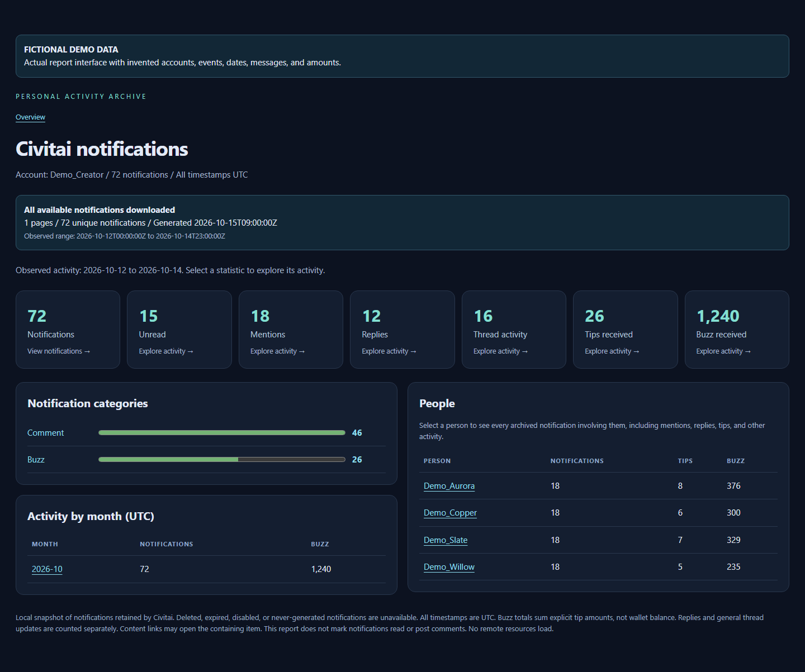
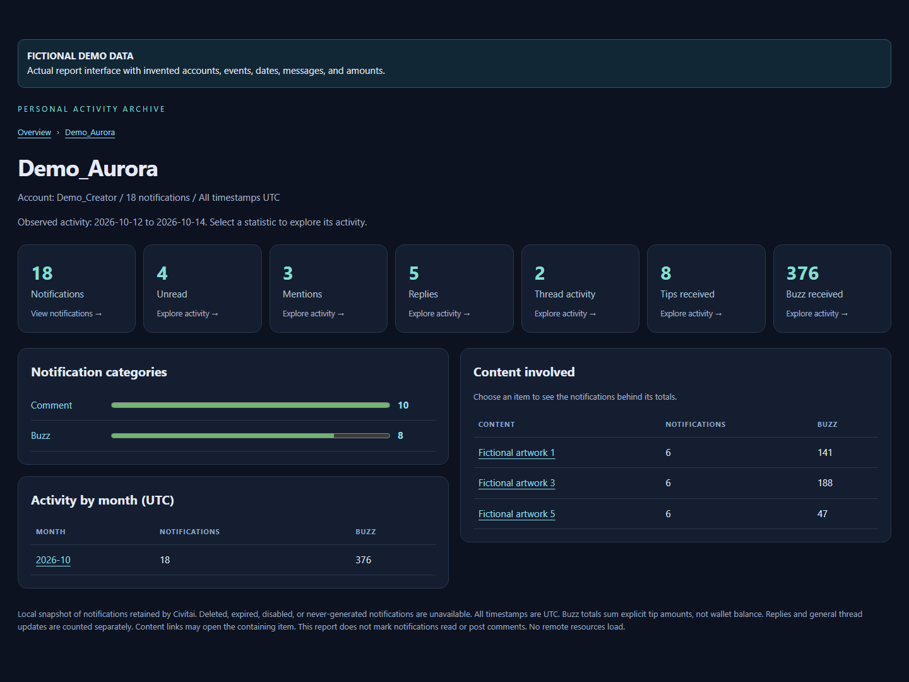
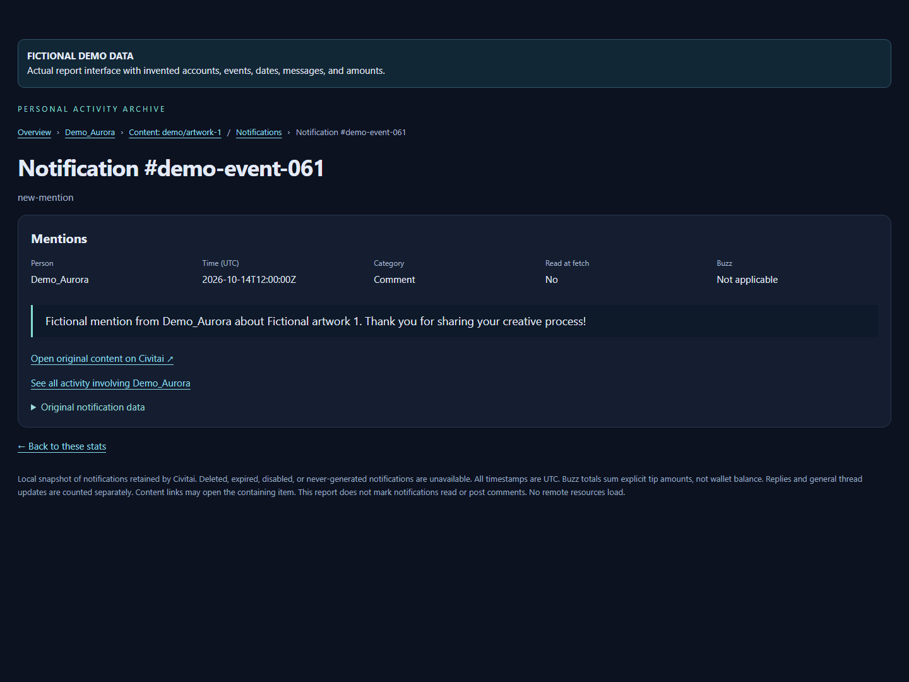

# Feature request: Notification Insights for Civitai Discovery

**Status: ON HOLD - future feature; not selected for implementation.**

Owner decision recorded November 3, 2026. This proposal is explicitly excluded from
the current release. No release milestone or delivery date is assigned. Resume only
when the owner explicitly selects it for a later release. Open a linked implementation
PR at that time; this documentation branch introduces no application feature.

The standalone local report is a working exploratory prototype. The screenshots
below show its actual UI with fictional data. Production integration into Discovery,
daily scheduling, and approved posting are separate future work.

## Problem

Creators receive a mix of mentions, replies, tips, thread updates, and other alerts.
A chronological notification feed makes it difficult to understand who is engaging,
which conversations need a response, and which work is receiving support. A flat
export preserves events but leaves the creator to reconstruct those relationships.

## Proposed experience

Add a Notifications area to Discovery that turns account activity into a connected
overview. Show mentions, replies, tips, and Buzz received as clickable summary cards.
Group activity by person, category, time period, and content. Every total should lead
to the exact notifications contributing to it.

Example flow: **person → tips → artwork → original notification**. A person page
includes all identifiable interactions, with general thread activity distinguished
from direct replies. An individual notification shows the message, timestamp, tip
amount when supplied, and a link to its original Civitai context.

Keep overview pages focused on widgets. Show event lists only on dedicated
drill-down pages, with breadcrumbs, pagination, and browser Back support. Stack short
widgets independently so a long people/content table does not create empty rows.

## Screenshots of the working report with fictional data

These screenshots use the **same report renderer, HTML template, styles, widgets,
and navigation as the working notification archive**. The only extra markup is a
visible fictional-data banner. All accounts, identifiers, content, dates, messages,
and amounts were invented; no real account archive was used as input.

The proposed Discovery integration should preserve this existing overview/person/
content/notification structure. Daily digests and reviewed replies remain future
requirements described below; they are not depicted as implemented controls.

## Scope and delivery stages

1. **Notification Insights MVP:** authenticated read-only synchronization, local
   persistence, account overview, person/content/date/category drill-downs, and
   individual event details. Include a manual refresh, selected time period, clear
   synchronization state, keyboard navigation, and responsive layouts.
2. **Daily digest:** summarize new activity since the last successful digest, link
   every summary item to supporting notifications, and let the user choose delivery
   time. Catch up after downtime without repeating previously summarized events.
3. **Reviewed replies:** draft responses using the actual conversation context.
   Show the exact text and destination for approval before posting. Posting access
   is a separate opt-in capability; there are no unattended comments in this proposal.

## MVP acceptance criteria

- Fetch all currently available notification categories, including notifications
  already read on Civitai. Deduplicate by account and notification ID.
- Persist complete source fields and page checkpoints transactionally. Resume an
  interrupted sync, honor rate limits, and show failures without claiming success.
- Use **“All available notifications downloaded”** on successful full traversal.
  Explain that older deleted/expired events may not be available. Show last successful
  sync, observed date range, and whether the current snapshot is incomplete or stale.
- Person pages count all archived events with an identifiable actor. Preserve
  notifications with missing actors; never guess who sent them.
- Counts, time periods, and Buzz totals reconcile with the contributing notification
  records. Tip totals are labeled separately from wallet balance and lifetime income.
- Any card/group can lead to its contributing events, including events without a
  resolvable content link. Dedicated lists retain filters and pagination state.
- Individual events display available source text, UTC/local-time labeling, read
  state at synchronization, and a validated Civitai link when one can be resolved.
- Desktop widgets have consistent widths and spacing; short panels do not wait
  below taller neighboring tables. Mobile has no document-wide horizontal overflow.
- Reading or summarizing never marks notifications read, sends messages, or posts
  comments implicitly. A separate explicit action is required for such changes.

## Engineering proposal

Extend the existing local persistence layer with account-scoped notification and sync
records rather than introducing a separate production database. Store string IDs,
raw JSON, notification types, actors when supplied, timestamps, and read state.
Derive dashboard aggregates from those records. Keep sync atomic, resumable, paced,
and isolated between accounts; retain already archived history if Civitai removes it.

The working archive demonstrates Civitai's authenticated notification-list endpoint
and timestamp pagination. Production integration needs its own verified auth/sync
contract and tests. Request notification-read permission explicitly and keep credentials
in the application's protected storage. Reading notifications must not require posting
permission. Reuse Discovery's existing shared outbound pacing where appropriate.

Preserve source data while rendering untrusted notification text as text. Validate
external destinations and avoid loading remote resources automatically. Provide
local deletion/export controls with clear account ownership and retention behavior.

For daily digests, save a successful-summary checkpoint independently of Civitai's
read status. For reviewed replies, fetch relevant context, show the destination and
final draft, and record outcomes. Never blindly retry a posting request with an
unknown result because it could create duplicate comments.

## Verification before release

Test real account read access, all pagination boundaries, duplicate IDs, missing
actors/content, large histories, Unicode, expired credentials, rate limits, interrupted
sync, and account switching. Reconcile displayed aggregates to persisted events.
Exercise complete drill-down paths and accessibility across supported viewport sizes
and browsers. For later stages, verify digest catch-up/deduplication and approved
posting against actual service behavior; mocked success alone is insufficient.

## Open product decisions

- Where should the daily digest appear: inside Discovery, a desktop notification,
  or an optional external delivery channel?
- Should users choose local retention limits, and how should deletion/export work?
- Which notification types should be prominent by default versus available through
  secondary category drill-downs?
- Can a local scheduled check run while Discovery is closed, and how is that state
  explained to the user?

## Prototype evidence and implementation boundary

The three attached screenshots were captured from the working local report's actual
renderer and template, populated entirely from a generated fixture. That fixture
contains 72 invented events across four Demo_* people: 18 mentions, 12 replies,
26 tips, and 1,240 Buzz. The only extra markup is a visible fictional-data banner.
Synthetic content links use the reserved example.invalid domain, not actual artworks.

Local Chromium verification established template equality apart from the data/banner,
checked the sample totals, and exercised overview/person/content/notification
navigation with no remote requests or JavaScript errors. Those checks validate the
standalone prototype using simulated data; they do not establish a finished Discovery
integration, production scheduling, or posting capability.

Only this proposal and three fictional screenshots are stored on this branch. No
private archive database, credentials, real-account screenshots, or user notification
data is included. Keep the issue open and labeled `on hold`, without a release
milestone, until the owner explicitly resumes it.
